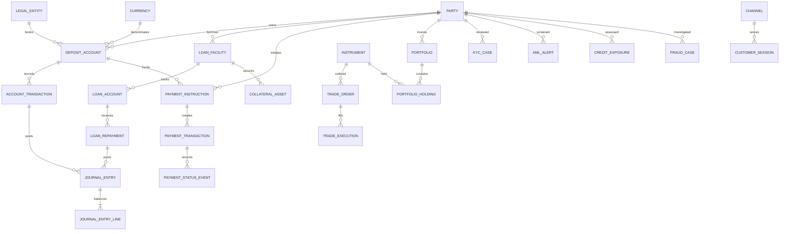

# Banking MVM: Source OLTP and Data Models

## Scope and assumptions

This is a PostgreSQL reference design based on the Databricks Banking MVM linked below. “MVM” is broad: the upstream model describes 17 domains and 227 analytical data products. The source model here is a normalized operational design to supply those products; it is not a claim that the lakehouse products are OLTP tables or that the upstream project defines one physical banking database.

The requested use-case field was left blank, so this document covers the full MVM at domain level and provides a practical transactional core in PostgreSQL. It assumes that the bank integrates multiple existing systems of record rather than replacing them with one database. The supplied DDL is an executable reference baseline for a consolidated OLTP implementation or a starting point for domain-owned schemas. It requires bank-specific review for regulatory jurisdiction, product rules, security controls, throughput, retention, and vendor source mappings.

Source: [Databricks Banking MVM](https://github.com/databricks-industry-solutions/lakehouse-industry-data-models/tree/main/data-models/banking/v1/mvm) (model version `v1_mvm`; accessed 2026-10-23). The upstream README describes 17 domains, 46 subdomains, 227 products, and 2,478 foreign-key references. Its products are analytical/curated data products, often intentionally denormalized.

## 1. Conceptual model

The bank serves people and organizations (`Party`) through customer, account, lending, payments, and wealth relationships. Account, loan, payment, trading, and investment activity creates operational events and financial postings; ledger and reference data provide control and reconciliation. Compliance, fraud, risk, collateral, treasury, and channel domains capture related control and operational records. Securities, investment banking, and asset-management entities represent the investment and markets businesses.

The diagram shows business concepts and ownership boundaries, not table-level foreign keys. Operational systems remain authoritative in their domain; the analytical lakehouse consumes changes from those systems.

<!-- mermaid-checked: every attribute is `<type> <name> [<key>] ["<description>"]` with at most one of PK/FK/UK, no \n in descriptions, no {} in descriptions, every relationship label is double-quoted -->

## 2. Logical model

The logical model separates reusable business entities from the analytical product shapes. The PostgreSQL design implements the central transactional entities below; each has a stable surrogate identifier except for reference values, which use standard codes. Relationships are enforced with foreign keys in the DDL.

### Core entity groups

| Domain | Logical entities in the source model | Main relationships |
|---|---|---|
| Party and customer | Party, Individual Profile, Corporate Profile, Party Identifier, Party Address, Party Contact, Party Relationship, Onboarding Case, KYC Case, KYC Review Event | A party can be a deposit-account holder, borrower, beneficiary, investor, or subject of compliance/risk records. Party subtypes share the party key. |
| Reference | Currency, Country, Product Type | Referenced by customer domicile, accounts, loans, ledger postings, and treasury positions. |
| Account | Deposit Account, Account Holder, Balance Snapshot, Account Transaction, Account Hold, Account Limit | Accounts belong to legal entities and may have multiple party holders. Transactions and holds affect operational balances. |
| Payment | Beneficiary, Payment Instruction, Payment Transaction, Payment Status Event, Payment Return | An instruction is initiated by a party and may debit a deposit account; attempts/events/returns are retained separately. |
| Lending and collateral | Loan Facility, Loan Account, Repayment Schedule, Loan Repayment, Collateral Asset, Facility Collateral Link | A facility belongs to a borrower; one facility may book multiple loan accounts and be secured by multiple collateral assets. |
| Ledger | Legal Entity, GL Account, Accounting Period, Journal Entry, Journal Entry Line | Each journal entry has one or more lines; lines reference GL accounts. Operational sources link to journal entries by source-system and source-record identifiers. |
| Markets and wealth | Instrument, Trade Order, Trade Execution, Settlement Instruction, Portfolio, Portfolio Holding, Portfolio Transaction | Orders may have multiple executions; portfolios hold financial instruments. |
| Control domains | Credit Exposure, AML Alert, AML Case, Fraud Case | Records reference the relevant party and, where applicable, account, payment, or facility. |
| Channel and treasury | Channel, Branch, Customer Session, Liquidity Position | Sessions associate customer activity with a channel; treasury positions are time-stamped and currency-denominated. |

### Upstream MVM product inventory

The following are the product/table names as cataloged by the upstream MVM. They are the analytical scope and should be mapped to one or more source entities/events, not copied blindly as a normalized OLTP schema.

| MVM domain | Upstream products |
|---|---|
| Customer | `party`, `individual_profile`, `corporate_profile`, `kyc_record`, `party_address`, `party_contact`, `party_document`, `relationship_hierarchy`, `segment`, `party_segment_assignment`, `onboarding_case`, `kyc_review_event`, `party_relationship`, `party_identifier`, `risk_rating`, `account_holder` |
| Account | `deposit_account`, `holder`, `balance`, `account_transaction`, `statement`, `interest_accrual`, `account_fee`, `hold`, `overdraft_facility`, `account_limit`, `status_history`, `interest_rate`, `standing_order`, `direct_debit_mandate` |
| Loan | `facility`, `credit_application`, `loan_account`, `amortization_schedule`, `drawdown`, `repayment`, `covenant`, `loan_ecl_provision`, `modification`, `collateral_link`, `write_off`, `credit_review`, `lc`, `lc_drawing`, `documentary_collection`, `bank_guarantee`, `trade_document`, `guarantee`, `disbursement`, `pricing` |
| Payment | `instruction`, `payment_transaction`, `status_event`, `return`, `clearing_record`, `routing`, `beneficiary`, `payment_mandate`, `card_transaction`, `sanction_screening`, `fx_transaction`, `correspondent_bank`, `payment_channel`, `reconciliation`, `card`, `merchant`, `reconciliation_item` |
| Security | `instrument`, `equity`, `fixed_income`, `derivative`, `issuer`, `price`, `corporate_action`, `classification`, `identifier`, `listing`, `benchmark`, `yield_curve`, `credit_rating` |
| Trade | `order`, `execution`, `capture`, `trade_position`, `mtm_valuation`, `settlement_instruction`, `confirmation`, `trading_book`, `allocation`, `trade_fee`, `counterparty_agreement`, `broker`, `clearing_house` |
| Investment banking | `deal`, `investment_mandate`, `transaction_structure`, `investment_valuation`, `fee_arrangement`, `syndication`, `underwriting`, `investor_order`, `coverage_assignment`, `deal_participant`, `offering`, `tranche` |
| Wealth | `managed_portfolio`, `investment_policy_statement`, `asset_allocation`, `portfolio_holding`, `portfolio_transaction`, `nav_calculation`, `rebalancing_order`, `performance_return`, `client_mandate`, `suitability_assessment`, `model_portfolio`, `fee_schedule`, `fee_billing`, `custodian_account`, `tax_lot`, `trust_account` |
| Risk | `factor`, `appetite`, `risk_limit`, `credit_exposure`, `market_risk_position`, `risk_ecl_provision`, `counterparty_rating`, `stress_scenario`, `stress_test_run`, `liquidity_metric`, `operational_risk_event`, `kri_measurement`, `assessment`, `scenario_appetite_result` |
| Collateral | `collateral_asset`, `pledge`, `margin_call`, `collateral_valuation`, `haircut_schedule`, `eligibility_rule`, `margin_agreement`, `collateral_position`, `margin_exposure`, `pledge_agreement`, `netting_set` |
| Treasury | `liquidity_position`, `liquidity_ratio`, `hqla_inventory`, `interbank_placement`, `repo_position`, `repo_transaction`, `ftp_rate`, `ftp_allocation`, `interest_rate_risk_position`, `capital_ratio`, `capital_plan`, `funding_plan`, `debt_issuance`, `nostro_account`, `cash_flow_forecast` |
| Ledger | `chart_of_accounts`, `gl_account`, `journal_entry`, `journal_entry_line`, `accounting_period`, `cost_center`, `legal_entity`, `subledger`, `trial_balance`, `intercompany_transaction`, `profit_center` |
| Compliance | `aml_alert`, `aml_case`, `kyc_review`, `sanctions_screening_event`, `regulatory_exam`, `regulatory_filing`, `obligation`, `ctr_filing`, `policy`, `monitoring_rule`, `sanctions_list_entry` |
| Channel | `channel`, `branch`, `atm`, `digital_channel`, `session`, `interaction`, `atm_transaction` |
| Reference | `currency`, `country`, `rate_benchmark`, `benchmark_rate_fixing`, `exchange_rate`, `holiday_calendar`, `holiday_date`, `bic_directory`, `lei_registry`, `product_type`, `jurisdiction`, `industry_code` |
| Fraud | `case`, `alert`, `investigation`, `incident`, `chargeback`, `sar_filing`, `loss_recovery`, `detection_rule`, `evidence`, `claim`, `network_link`, `subject` |
| Asset management | `fund`, `fund_class`, `nav_record`, `fund_holding`, `fund_transaction`, `investor_account`, `subscription`, `redemption`, `distribution_event`, `unit_register`, `fund_mandate`, `investment_restriction`, `fund_performance` |

### Source-system ownership and integration

The upstream model names example systems of record, not mandatory products. Assign each entity to the institution's actual system and retain that source key in the integration layer.

| Source domain | Example system of record named by the upstream model | Logical ownership |
|---|---|---|
| Customer and retail accounts | Core banking system (e.g. Temenos T24 / FIS Profile) | Party identity, deposit-account lifecycle, balances, account transactions |
| Credit and commercial lending | Loan origination / servicing (e.g. Finastra Fusion Loan IQ) | Applications, facilities, loan booking, covenants, repayment servicing |
| Payments | Payment hub (e.g. ACI Worldwide / Volante) | Payment instructions, processing attempts, clearing and return events |
| Trading and securities | Trading / order management (e.g. Murex / Calypso) | Instrument references, orders, executions, positions, settlement |
| Risk | Risk platform (e.g. SAS Risk Management / Moody's RiskAuthority) | Risk limits, exposures, stress/scenario results |
| Financial crime | AML platform (e.g. NICE Actimize / Oracle Financial Crime) | Alerts, cases, screening decisions and filings |
| Wealth and asset management | Portfolio platform (e.g. SimCorp Dimension / BlackRock Aladdin) | Mandates, portfolios, holdings, valuations, fund activity |
| General ledger | Financial accounting system (e.g. Oracle Financials / SAP S/4HANA) | Chart of accounts, periods, journal entries and lines |
| Regulatory reporting | Reporting platform (e.g. AxiomSL / Wolters Kluwer OneSumX) | Regulatory submissions and report-specific snapshots |

Use CDC or transactional outbox feeds for committed source changes, immutable source event identifiers for idempotency, and a cross-reference table in the integration layer for source-system IDs to canonical IDs. Do not make one source OLTP database synchronously depend on another source system's tables. Reporting aggregates, ECL calculations, stress outputs, and other MVM products belong in analytical/derived stores, not in the transactional write path.

## 3. Physical model

The accompanying [banking-mvm-postgresql.sql](./banking-mvm-postgresql.sql) defines the physical reference schema. It creates PostgreSQL schemas by bounded context and normalized operational tables for party, account, payments, lending/collateral, ledger, securities/trading, wealth, controls, channels, and treasury.

Physical conventions:

- Internal primary keys use `BIGINT GENERATED BY DEFAULT AS IDENTITY`; externally supplied identifiers are stored separately and scoped by source system.
- Monetary values use `NUMERIC`, with currency represented explicitly. Amount precision and rounding policies must be finalized by product and jurisdiction.
- Reference codes use ISO-style natural keys where appropriate; `TIMESTAMPTZ` is used for instants and `DATE` for business dates.
- Mutable master/current-state rows have creation/update timestamps. Financial events and audit/event tables are append-oriented; corrections should be compensating records rather than silent overwrites.
- The `account.balance_snapshot` table is a queryable current/snapshot projection, not a replacement for the transaction ledger. Available balance must be maintained atomically with posting and hold changes in the owning account system.
- Source event IDs should be unique within a source system for safe replay. The DDL includes source identity fields on the event tables where practical; production CDC/outbox contracts must define ordering and replay behavior.
- PII and financial identifiers require encryption/tokenization and strict access controls. The DDL uses ciphertext/fingerprint columns for government identifiers and account numbers; encryption keys must be managed outside PostgreSQL. Do not store card security codes; use a PCI-compliant tokenization provider for payment card data.
- A bank deploying separate systems of record should split physical ownership by domain and replace cross-schema foreign keys with stable canonical IDs and integration contracts where synchronous database constraints would cross service boundaries.

### Scope limitations

The provided SQL is a normalized starter schema for the central OLTP entities, not a complete implementation of all 227 analytical products or the behavior of any named banking vendor. Some MVM products are derived, time-series, regulatory, or analytical structures and need source-to-target mappings and domain-specific extensions. In particular, full card processing, securities reference data, trade finance, investment-banking deals, detailed treasury instruments, regulatory reporting, and all jurisdictional compliance requirements need separately agreed specifications before production use.
